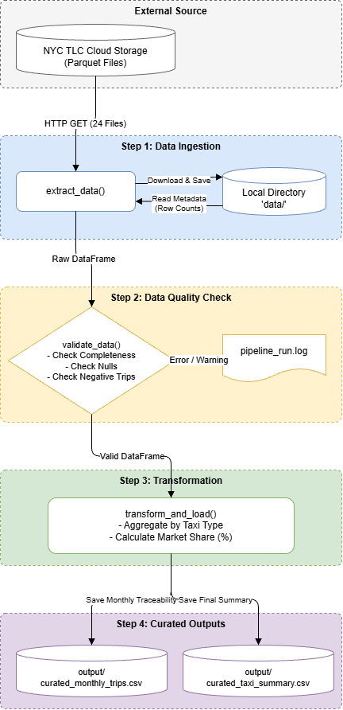
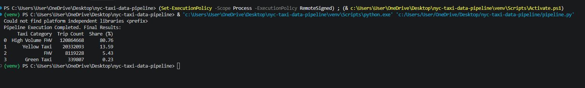
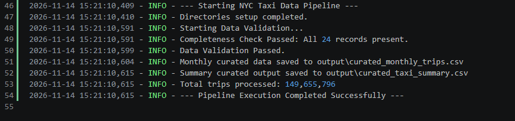

# NYC Taxi — Reproducible Data Pipeline (Submission 2)

**คำถามหลัก (Core Question):** Which taxi type was the most used in the first half of 2024?

**นิยามของคำว่า "most used":** ประเภทบริการแท็กซี่ที่มีจำนวนเที่ยวการเดินทางที่ถูกบันทึกไว้ (**Total Trip Records**) มากที่สุดในช่วงวันที่ `2024-01-01` ถึง `2024-06-30` (วัดจากความถี่ในการใช้งาน ไม่ใช่รายได้หรือระยะทาง)

**คำตอบสรุป:** **High Volume FHV** เป็นประเภทที่ถูกใช้งานมากที่สุด ด้วยจำนวน **120,864,668 เที่ยว (80.76%)** ซึ่งสูงกว่าอันดับสองอย่าง Yellow Taxi (20,332,093 เที่ยว) ประมาณ **5.94 เท่า**

---

## 1. ข้อมูลที่ใช้ (Data Sources & Schema Integration)

โปรเจกต์นี้ดึงข้อมูลบันทึกการเดินทางของแท็กซี่ในนครนิวยอร์กจาก **NYC Taxi & Limousine Commission (TLC)** จำนวนทั้งหมด **24 ไฟล์** (4 ประเภทบริการ × 6 เดือน)
* **เว็บไซต์โครงการ (Official Website):** https://www.nyc.gov/site/tlc/about/tlc-trip-record-data.page
* **Storage Endpoint ที่ใช้ดึงไฟล์:** `https://d37ci6vzurychx.cloudfront.net/trip-data`

| ประเภทบริการ (Taxi Category) | รูปแบบชื่อไฟล์ (Parquet) | คอลัมน์เวลาใน Schema ต้นฉบับ | จำนวนไฟล์ | ยอดรวมเที่ยว (H1 2024) |
| :--- | :--- | :--- | :---: | :---: |
| **Yellow Taxi** | `yellow_tripdata_YYYY-MM.parquet` | `tpep_pickup_datetime` / `tpep_dropoff_datetime` | 6 | 20,332,093 |
| **Green Taxi** | `green_tripdata_YYYY-MM.parquet` | `lpep_pickup_datetime` / `lpep_dropoff_datetime` | 6 | 339,807 |
| **FHV** | `fhv_tripdata_YYYY-MM.parquet` | `pickup_datetime` / `dropOff_datetime` | 6 | 8,119,228 |
| **High Volume FHV** | `fhvhv_tripdata_YYYY-MM.parquet` | `pickup_datetime` / `dropoff_datetime` | 6 | 120,864,668 |

**วิธีการบูรณาการข้อมูลต่างโครงสร้าง (Schema Integration):** เนื่องจากไฟล์ทั้ง 4 ประเภทมีชื่อคอลัมน์และจำนวนฟิลด์ไม่เหมือนกัน Pipeline จึงสกัดข้อมูลจาก **Parquet File Metadata** (`num_rows`) และแปลงให้อยู่ใน Schema กลางเดียวกันคือ `["Taxi Category", "YearMonth", "Trip Count"]` ก่อนนำมารวมยอดข้ามบริการ

---

## 2. Pipeline / Data Flow Diagram



---

## 3. วิธีติดตั้งและวิธีรัน (Installation & Reproducibility)

### ขั้นตอนการติดตั้งและรันครั้งแรก
1. **Clone repository และเข้าไปที่โฟลเดอร์โปรเจกต์:**
   ```bash
   git clone [https://github.com/YokoYoko48/nyc-taxi-data-pipeline.git](https://github.com/YokoYoko48/nyc-taxi-data-pipeline.git)
   cd nyc-taxi-data-pipeline
   ```
2. **สร้างและเปิดใช้งาน Virtual Environment (แนะนำ):**
   ```bash
   python -m venv venv
   # สำหรับ Windows PowerShell:
   .\venv\Scripts\Activate.ps1
   # สำหรับ macOS / Linux:
   source venv/bin/activate
   ```
3. **ติดตั้งไลบรารีที่จำเป็น:**
   ```bash
   pip install -r requirements.txt
   ```
4. **รัน Data Pipeline:**
   ```bash
   python pipeline.py
   ```

### การรันซ้ำและการอัปเดตข้อมูลใหม่ (Re-run & Incremental Update)
* **การรันซ้ำ (Idempotency):** หากสั่งรัน `python pipeline.py` ซ้ำ ระบบจะตรวจสอบผ่าน `if not file_path.exists()` และข้ามการดาวน์โหลดไฟล์ Parquet ที่มีอยู่แล้วใน `data/` ทันที ช่วยประหยัดเวลาและแบนด์วิดท์ โดยยังคงได้ผลลัพธ์เหมือนเดิมทุกประการ
* **การอัปเดตช่วงเวลาใหม่:** สามารถปรับค่าตัวแปร `YEAR` และ `MONTHS` ในฟังก์ชัน `main()` ของไฟล์ `pipeline.py` (เช่น เปลี่ยนเป็น `MONTHS = range(1, 13)` เพื่อดึงข้อมูลทั้งปี) แล้วสั่งรันใหม่ ระบบจะดาวน์โหลดเฉพาะไฟล์เดือนใหม่มาประมวลผลต่อให้อัตโนมัติ

---

## 4. โครงสร้าง Repository (Repository Structure)

```text
nyc-taxi-data-pipeline/
├── pipeline.py                     # Source code หลักของ ETL Pipeline (Extract, Validate, Transform & Load)
├── requirements.txt                # รายการ Python packages ที่ใช้ (pandas, pyarrow, requests)
├── pipeline_run.log                # หลักฐานการรันและบันทึกผลการตรวจสอบคุณภาพข้อมูล (Audit Trail)
├── pipeline_diagram.png            # แผนภาพแสดงสถาปัตยกรรมและการไหลของข้อมูล (Data Flow Diagram)
├── terminal_run.png                # ภาพหลักฐานผลลัพธ์จากการรันผ่าน Terminal
├── log_evidence.png                # ภาพหลักฐานบันทึกการทำงานและการรันซ้ำในไฟล์ Log
├── README.md                       # เอกสารอธิบายภาพรวม วิธีใช้งาน และการวิเคราะห์ผล
├── .gitignore                      # ตั้งค่าละเว้นโฟลเดอร์ data/, venv/ และ __pycache__/
├── data/                           # โฟลเดอร์เก็บไฟล์ดิบ .parquet (ถูกสร้างอัตโนมัติเมื่อรัน, ไม่เก็บใน Git)
└── output/                         # โฟลเดอร์เก็บชุดข้อมูลพร้อมใช้ (Curated Outputs)
    ├── curated_monthly_trips.csv   # ข้อมูลยอดเที่ยวรายเดือนแยกตามประเภทบริการ (24 แถว)
    └── curated_taxi_summary.csv    # ตารางสรุปยอดรวมและสัดส่วน Market Share (4 แถว)
```

---

## 5. การตรวจสอบคุณภาพข้อมูล (Data Quality Checks)

ฟังก์ชัน `validate_data(df, expected_records)` ทำหน้าที่ตรวจสอบคุณภาพข้อมูลก่อนส่งต่อไปยังขั้นตอนคำนวณ โดยแบ่งการตรวจออกเป็น 3 เกณฑ์หลัก:

1. **Completeness Check (ความครบถ้วนของไฟล์):** ตรวจสอบว่าจำนวนระเบียนที่อ่านได้ตรงกับจำนวนไฟล์ที่คาดหวัง (`4 ประเภท × 6 เดือน = 24 ไฟล์`) หากไม่ครบระบบจะแจ้งเตือน (`WARNING`) ลงใน Log ทันที
2. **Null / Missing Value Check (ความสมบูรณ์ของฟิลด์):** ตรวจสอบค่าว่าง (`df.isnull().values.any()`) หากพบจะบันทึกคำเตือนและจัดการตัดแถวที่ไม่สมบูรณ์ออก (`dropna()`)
3. **Domain / Range Check (ความสมเหตุสมผลของตัวเลข):** ตรวจสอบว่าค่า `Trip Count` ต้องไม่ติดลบ (`< 0`) หากพบค่าผิดปกติ Pipeline จะหยุดทำงานและโยน `ValueError` เพื่อป้องกันผลลัพธ์ผิดพลาด

### สรุปผลการตรวจสอบคุณภาพข้อมูล (H1 2024)
| รายการตรวจสอบ (Validation Rule) | เกณฑ์ที่กำหนด | ผลลัพธ์ที่ได้ | สถานะ |
| :--- | :--- | :--- | :---: |
| ความครบถ้วนของไฟล์ต้นฉบับ | 24 ไฟล์ (Jan–Jun 2024) | 24 / 24 ไฟล์ | **PASS** |
| ค่าว่าง (Null / NaN Values) | 0 แถว | 0 แถว | **PASS** |
| ค่าติดลบ (`Trip Count < 0`) | 0 แถว | 0 แถว | **PASS** |
| ความสอดคล้องยอดรวม (Reconciliation) | ยอดรวมรายเดือน = ยอดสรุปสุดท้าย | 149,655,796 = 149,655,796 | **PASS** |

---

## 6. หลักฐานการรัน Pipeline (Evidence of Execution)

สถานะการทำงานและผลการตรวจสอบคุณภาพข้อมูลทั้งหมดถูกบันทึกพร้อม Timestamp ลงในไฟล์ `pipeline_run.log` โดยสามารถรันซ้ำได้โดยไม่เกิดข้อผิดพลาด

### 6.1 ผลลัพธ์จากการรันผ่าน Terminal (`python pipeline.py`)


### 6.2 บันทึกสถานะการทำงานและการรันซ้ำ (`pipeline_run.log`)


---

## 7. ผลการวิเคราะห์ (Analysis Results & Traceability)

ผลลัพธ์จากไฟล์ `output/curated_taxi_summary.csv` (สามารถตรวจสอบย้อนกลับไปยังยอดรายเดือนทั้ง 24 แถวใน `output/curated_monthly_trips.csv` ได้ครบถ้วน):

| อันดับ (Rank) | ประเภทบริการ (Taxi Category) | จำนวนเที่ยวรวม (Trip Count) | สัดส่วน (Share %) |
| :---: | :--- | :---: | :---: |
| **1** | **High Volume FHV** | **120,864,668** | **80.76%** |
| **2** | **Yellow Taxi** | 20,332,093 | 13.59% |
| **3** | **FHV** | 8,119,228 | 5.43% |
| **4** | **Green Taxi** | 339,807 | 0.23% |
| — | **รวมทั้งหมด (Total H1 2024)** | **149,655,796** | **100.00%** |

### ความหมายของผลลัพธ์ (Insights)
* **การครองตลาดของบริการเรียกรถผ่านแอป (App-based Ride-Hailing):** High Volume FHV (เช่น Uber และ Lyft) มีสัดส่วนการใช้งานสูงถึง 80.76% ของการเดินทางทั้งหมด สะท้อนพฤติกรรมผู้โดยสารในนิวยอร์กที่พึ่งพาแพลตฟอร์มดิจิทัลเป็นหลัก
* **บทบาทของแท็กซี่ดั้งเดิม:** หากพิจารณาเฉพาะแท็กซี่ที่กำกับดูแลโดยตรงแบบเรียกรถริมทาง (Yellow และ Green Taxi) พบว่า Yellow Taxi ครองสัดส่วนสูงถึง 98.36% ของกลุ่มนี้ (20.33 ล้านเที่ยว เทียบกับ Green Taxi 0.34 ล้านเที่ยว) เนื่องจากพื้นที่ให้บริการหลักอยู่ในเขต Manhattan และสนามบินสำคัญ

---

## 8. การตัดสินใจสำคัญในการออกแบบ (Key Design Decisions)

1. **อ่านข้อมูลระดับ Parquet Metadata (`pyarrow.parquet`) แทนการโหลดข้อมูลทั้งก้อนเข้า RAM:** ข้อมูลทั้ง 24 ไฟล์มีจำนวนรวมเกือบ 150 ล้านแถว การโหลดทุกคอลัมน์เข้า Pandas DataFrame พร้อมกันจะทำให้ใช้หน่วยความจำสูงเกินจำเป็น การใช้ `pq.ParquetFile(file_path).metadata.num_rows` ช่วยให้สกัดจำนวนเที่ยวได้อย่างรวดเร็ว ใช้ RAM ต่ำมาก และหลีกเลี่ยงปัญหา Schema ที่ต่างกันของแต่ละบริการ
2. **แยกสถาปัตยกรรมเป็น Modular ETL Functions:** ปรับโครงสร้างโค้ดจาก Notebook เดิมให้แยกหน้าที่ชัดเจนระหว่าง `extract_data()`, `validate_data()`, และ `transform_and_load()` ทำให้ง่ายต่อการดูแลรักษา ทดสอบเฉพาะส่วน และขยายขอบเขตการดึงข้อมูลในอนาคต
3. **ส่งออก Curated Outputs สองระดับ (`monthly` และ `summary`):** นอกเหนือจากตารางสรุปผลสุดท้าย ยังบันทึก `curated_monthly_trips.csv` เก็บไว้ด้วย เพื่อให้ผู้วิเคราะห์สามารถตรวจสอบย้อนกลับ (Traceability) และนำไปสร้างกราฟแนวโน้มรายเดือนต่อได้ทันทีโดยไม่ต้องกลับไปอ่านไฟล์ Parquet ดิบซ้ำ
4. **ทำ File-Level Caching และ Audit Logging (`pipeline_run.log`):** ตรวจสอบไฟล์ใน `data/` ก่อนดาวน์โหลดเพื่อป้องกันการโหลดซ้ำเมื่อรัน Pipeline ใหม่ และใช้ไลบรารี `logging` แทน `print()` เพื่อเก็บหลักฐานสถานะการทำงานและผล Data Quality Check อย่างเป็นระบบ

---

## 9. การพัฒนาจาก Submission 1 และข้อจำกัด (Baseline vs. Pipeline)

| มิติการเปรียบเทียบ | Submission 1 (Colab Notebook Baseline) | Submission 2 (Reproducible Data Pipeline) |
| :--- | :--- | :--- |
| **รูปแบบการทำงาน** | โค้ดแบบ Cell-based ใน Notebook ต้องกดรันทีละส่วนด้วยมือ | Modular Python Script (`pipeline.py`) รันจบครบวงจรด้วยคำสั่งเดียว |
| **การรันซ้ำและอัปเดต** | Hardcode ช่วงเดือนไว้ในโค้ด หากอัปเดตข้อมูลต้องแก้หลายจุด | กำหนดผ่านพารามิเตอร์ `YEAR` / `MONTHS` และข้ามไฟล์ที่โหลดแล้วอัตโนมัติ |
| **การตรวจสอบคุณภาพ** | ใช้ `assert` พื้นฐานในเซลล์ท้ายสุดของ Notebook | มีฟังก์ชัน `validate_data()` แยกเฉพาะ ตรวจทั้งความครบถ้วน Null และค่าติดลบ |
| **ผลลัพธ์ (Outputs)** | แสดงผลตารางและกราฟเฉพาะบนหน้าจอ Notebook | ส่งออกไฟล์พร้อมใช้ `curated_monthly_trips.csv` และ `curated_taxi_summary.csv` |
| **หลักฐานการทำงาน** | ไม่มีไฟล์บันทึกประวัติการรันแยกต่างหาก | มีไฟล์ `pipeline_run.log` บันทึก Timestamp และสถานะทุกขั้นตอน |

### ข้อจำกัดของ Pipeline ปัจจุบัน (Current Limitations)
1. **การตรวจคุณภาพยังอยู่ที่ระดับไฟล์ (File-Level Metadata):** เนื่องจากใช้วิธีนับจำนวนแถวจาก Metadata จึงยังไม่ได้กรองข้อมูลผิดปกติระดับแถว (Row-level anomalies) เช่น แถวที่เวลาส่งผู้โดยสารเกิดก่อนเวลารับ หรือค่าโดยสาร/ระยะทางเป็นศูนย์
2. **ยังต้องสั่งรันด้วยตนเอง (Manual Trigger):** ปัจจุบันสั่งรันผ่าน CLI บนเครื่อง Local ยังไม่ได้ตั้งเวลาทำงานอัตโนมัติ (เช่น Cron Job, GitHub Actions หรือ Apache Airflow)
3. **การจัดเก็บข้อมูลบน Local Storage:** ไฟล์ Parquet ดิบถูกเก็บไว้ในโฟลเดอร์ `data/` บนเครื่อง หากขยายขอบเขตข้อมูลเป็นหลายปี อาจต้องย้ายการจัดเก็บไปยัง Cloud Data Lake (เช่น AWS S3) เพื่อรองรับขนาดข้อมูลที่ใหญ่ขึ้น

---

## 10. Learning Reflection

การเปลี่ยนงานจาก Jupyter Notebook ใน Submission 1 มาเป็น Data Pipeline ในรอบนี้ ทำให้เห็นความสำคัญของการออกแบบโครงสร้างโค้ดให้เป็นโมดูล (Modularity) และการทำระบบ Logging เพื่อเก็บหลักฐานการทำงานที่ตรวจสอบย้อนกลับได้จริง การเพิ่มขั้นตอน Data Validation และส่งออกข้อมูลในรูปแบบ Curated CSV ช่วยแยกส่วนการเตรียมข้อมูลออกจากการวิเคราะห์ ทำให้มั่นใจได้ว่าข้อมูลพร้อมนำไปใช้งานต่ออย่างถูกต้อง นอกจากนี้ การออกแบบให้ข้ามการดาวน์โหลดไฟล์ที่มีอยู่แล้วช่วยให้การทดสอบและรันซ้ำทำได้รวดเร็วและเสถียรมากขึ้น อย่างไรก็ตาม ระบบปัจจุบันยังมีข้อจำกัดเรื่องการตรวจสอบข้อมูลระดับแถวและการตั้งเวลาทำงานอัตโนมัติซึ่งสามารถต่อยอดได้ในอนาคตเ